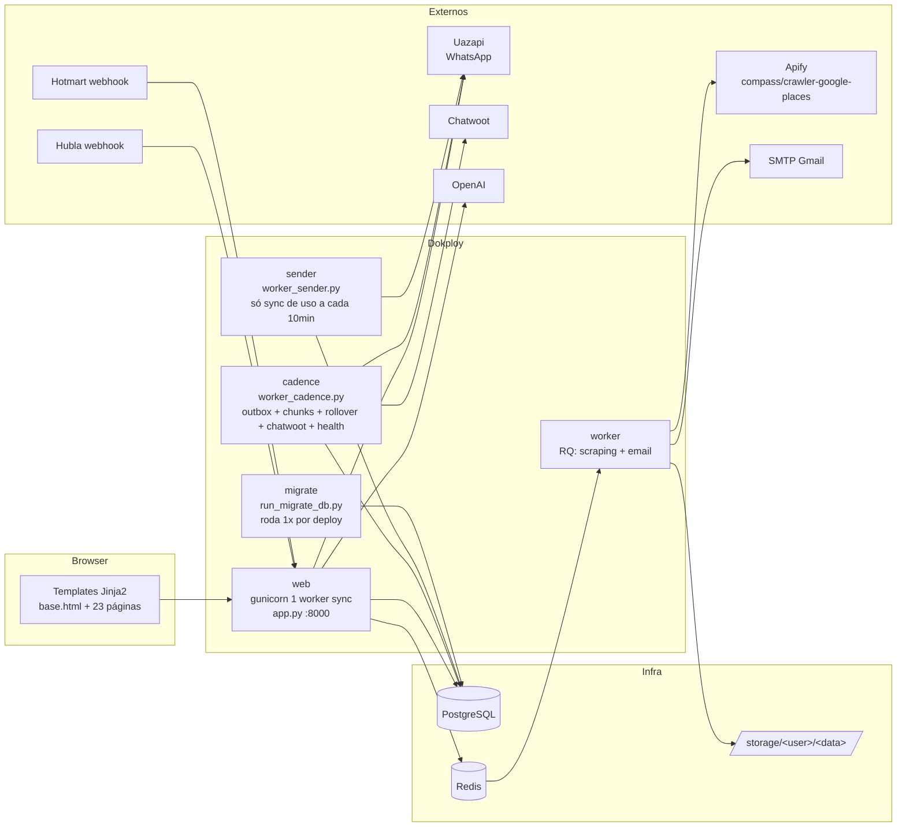
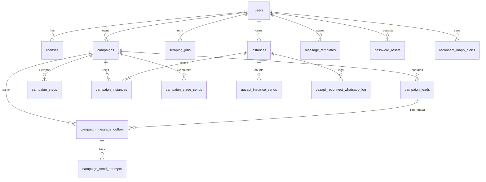

# Leads Infinitos — Mapa do Sistema (PRD reverso)

> Gerado em 2026-10-12 a partir do commit `cd9bc14` (main). Lido do código, não da documentação antiga.
> Objetivo: enxergar o que existe hoje, módulo a módulo, para decidir o que fica, o que sai e o que vira base da próxima versão (Apify novo).
> Diagrama visual complementar: `docs/MAPA_SISTEMA.html` (abrir no browser).

---

## 0. Resumo em uma tela

| Dimensão | Valor |
|---|---|
| Produto | SaaS: extrai leads do Google Maps (Apify) → monta campanhas WhatsApp (Uazapi) → cadência de follow-up com kanban |
| Código principal | `app.py` com **11.057 linhas**, 8 classes de domínio, **~130 rotas Flask** |
| Workers | 5 processos (`web`, `worker` RQ, `sender`, `cadence`, `migrate`) via docker-compose/Dokploy |
| Banco | PostgreSQL 15 com **22 tabelas**; schema criado por `init_db()` com ~60 `ALTER TABLE ADD COLUMN IF NOT EXISTS` encadeados |
| Integrações | Apify, Uazapi (WhatsApp), Chatwoot, OpenAI, Hotmart, Hubla, SMTP Gmail, Redis/RQ, Prometheus |
| Feature flags | **~45 variáveis de ambiente** (`UAZAPI_*`, `OUTBOX_*`, `SUPPORT_*`) controlando comportamento do motor de envio |
| Templates | 24 páginas Jinja2 (dark theme + modo claro, vídeo de fundo) |
| Testes | 34 arquivos pytest (dependem de Postgres real) |
| Histórico | 342 commits, ago/2025 → ago/2026; pico mar/2026 (migração MegaAPI → Uazapi) |
| Peso morto no repo | `_bmad/` (657 arquivos, 5,6 MB), `.cursor/commands` (77), vídeos em `static/` (6,8 MB), `app.py.bak`, `app.py.backup`, `uazapi-openapi-spec (1).yaml` (450 KB) |

**Diagnóstico curto:** o produto tem 3 camadas bem separáveis: (1) **extração** (funciona, simples, isolada), (2) **shell de UI + conta + licença** (bom, reaproveitável), (3) **motor de envio WhatsApp** (três gerações de implementação coexistindo, é onde moram os bugs e as regras conflitantes). A camada 3 é ~70% do código.

---

## 1. Topologia de runtime



Observações:
- `worker_cadence.py` é o único processo que de fato envia mensagens hoje (tick do outbox, chunks, rollovers, Chatwoot, saúde das instâncias). Ponto único de falha.
- `worker_sender.py` virou casca: o loop só chama `_sync_uazapi_usage` a cada 10 min. Container inteiro para isso.
- A imagem Docker herda de `mcr.microsoft.com/playwright/python` e instala Chromium, mas o scraping é 100% Apify. Playwright é peso morto.

---

## 2. Menu e navegação (o que o usuário vê)

```
Início (/)             → formulário Nova Extração
Dashboard (/dashboard) → KPIs do mês + Ações Rápidas
Jobs (/jobs)           → lista de extrações, progresso, cancelar, baixar CSV/XLSX
Campanhas (/campaigns) → lista → Nova campanha (wizard) · Kanban · Editar leads · Excluir
WhatsApp (/whatsapp)   → instâncias Uazapi: criar, QR code, status, excluir
Minha Conta (/account) → dados, licença, instâncias + limite diário, trocar senha, ajuda
Sair
[Super Admin] (/admin) → Usuários · Campanhas · Auditoria de disparos
Sem login: Entrar · Criar conta · Esqueci senha
```

---

## 3. Módulos

Legenda de rotas: `app.py:<linha>`. Tabelas em `monospace`.

### M1 · Autenticação e Conta
- **Rotas:** `/register`, `/login`, `/api/login`, `/logout`, `/forgot-password`, `/reset-password/<token>`, `/change-password`, `/account`, `/api/account/instances`, `/api/account/instances/<id>/daily-limit`
- **Tabelas:** `users` (email, password_hash, is_admin, display_name, phone_e164), `password_resets`
- **Depende de:** Flask-Login, SMTP via RQ (`worker_email.py`) para reset
- **Estado:** funcional, pequeno, independente. Super admin é por e-mail hardcoded em `utils/config.py` (`SUPER_ADMIN_EMAILS` default com dois e-mails).

### M2 · Licenças e Planos
- **Rotas:** `/licenses`, `/api/verify-license`, `/webhook/hubla`, `/api/webhooks/hotmart`, `/api/provision/user`, `/api/provision/license` (server-to-server, `PROVISION_API_SECRET`), `/cron/expire-starter-trial` (`CRON_SECRET`), admin `/admin/licenses/create`, `/admin/licenses/<id>/revoke`
- **Tabelas:** `licenses`, `hubla_webhooks`, `hubla_config`, `hotmart_webhooks`, `hotmart_config`, `monthly_usage_history`
- **Fonte única de regras:** `utils/limits.py::PLAN_POLICY`

| Plano | Instâncias | Extrações/mês | Disparos/dia/instância | Validade |
|---|---|---|---|---|
| starter_trial | 1 | 100 | 10 | 7 dias |
| starter | 1 | 1.000 | 30 | 365 |
| pro | 2 | 2.000 | 30 | 365 |
| scale | 4 | 4.000 | 60 | 365 |
| infinite | 20 | 10.000 | 30 (opções 10–50) | 365 |

- **Conflitos:** duas plataformas de pagamento (Hotmart e Hubla) com classes e tabelas duplicadas; fallback `semestral`/`anual` → `pro` ainda vivo; `scale` tem 60/dia por instância mas o teto por campanha é 30 (`CAMPAIGN_DAILY_LIMIT_MAX`), então o limite do plano nunca é atingível por uma campanha só.

### M3 · Extração Google Maps (Apify)
- **Fluxo:** `index.html` (palavra-chave + até 15 localizações + total 1–500) → `POST /scrape` (`app.py:2594`) valida licença e cota mensal → `ScrapingJob.create` → `q.enqueue(run_scraper_task)` → `worker_scraper.py` → `main.run_apify_scraper` → Actor `compass/crawler-google-places` por localização → `BusinessList` dedup + coluna `status=1` → CSV + XLSX em `storage/<uid>/<YYYY-MM-DD>/` → `scraping_jobs.results_path`
- **Rotas:** `/scrape`, `/jobs`, `/api/scraping-jobs`, `/api/job/<id>` (GET/DELETE), `/api/job/<id>/cancel`, `/download`, admin `/api/admin/users/<id>/scraping-jobs`, `/api/admin/scraping-jobs/<id>/download-csv`
- **Tabelas:** `scraping_jobs` (status pending/running/completed/failed/cancelled, progress, current_location, lead_count)
- **Regras:** sufixo `, Brasil` forçado; `countryCode=br`; `language=pt-BR`; cota mensal contada por ciclo da licença (`get_monthly_lead_count`)
- **Estado:** isolado e limpo. É exatamente o ponto onde entra a nova API do Apify: trocar `run_apify_scraper` (`main.py:191`) e o mapeamento de campos para `Business`.
- **Bug:** `/download` está definida duas vezes (`app.py:2733` com checagem de dono; `app.py:8403` `download_file` **sem checagem**, envia qualquer path do disco). Qual vence depende da ordem de registro do Werkzeug. Remover a segunda.

### M4 · Instâncias WhatsApp (Uazapi)
- **Rotas:** `/whatsapp`, `/api/whatsapp/init`, `/api/whatsapp/qr/<key>`, `/api/whatsapp/status/<key>`, `/api/whatsapp/delete/<key>`, `/api/reconnect-alerts/<id>/dismiss`, admin `/admin/users/<id>/instances` (POST), `/admin/users/<id>/instances/<iid>/token`, `/admin/whatsapp/check_status/<apikey>`
- **Tabelas:** `instances` (name, server_url, apikey, status, api_provider, daily_sends_per_instance, last_disconnect_notify_at, worker_last_uazapi_disconnected), `reconnect_inapp_alerts`, `uazapi_reconnect_whatsapp_log`, `uazapi_instance_sends`
- **Serviço:** `services/uazapi.py::UazapiService` (create_instance, connect, get_status, delete, send_text, send_text_idempotent, send_media, check_phone, create_advanced_campaign, edit_campaign, list_folders, list_messages, message_find)
- **Conflito:** `instances.api_provider DEFAULT 'megaapi'` e dezenas de `COALESCE(api_provider,'megaapi')` espalhados, embora MegaAPI tenha sido removida em mar/2026. Toda query de instância precisa filtrar `= 'uazapi'`.

### M5 · Campanhas (CRUD e wizard)
- **Rotas:** `/campaigns`, `/campaigns/new`, `/campaigns/<id>/edit`, `/campaigns/delete/<id>`, `POST /api/campaigns`, `/api/upload-csv-leads`, `/api/campaigns/<id>/update`, `/api/campaigns/<id>/leads` (GET, DELETE lead), `/api/campaigns/<id>/replace-leads`, `/api/campaigns/<id>/steps/<n>` (GET/POST), `/api/templates`, `/api/ai/generate-copy` (OpenAI), `/api/campaigns/<id>/toggle_pause`
- **Wizard `campaigns_new.html` (1.704 linhas):** nome → mensagem inicial (variações/spintax, `{{nome}}`) → limite diário em pacotes 5/10/15/20/25/30 → modo cadência (`kanban_later` ou `now`) → 4 etapas (Inicial, Follow-up 1, Follow-up 2, Break-up) com `delay_days` e mídia → instâncias (checkbox, `rotation_mode` single/round_robin) → janela de envio (`send_hour_start/end`, sábado/domingo) → delays → termos de responsabilidade
- **Tabelas:** `campaigns` (28 colunas, das quais 21 via ALTER), `campaign_leads` (27 extras), `campaign_steps`, `campaign_instances`, `message_templates`
- **Upload CSV:** `utils/validate_job_csv.py`; aceita CSV da extração ou planilha mínima (`docs/modelo-planilha-campanhas-*.csv`); guarda `csv_row_order` para manter ordem de disparo
- **Estado:** UI boa e reaproveitável. O backend `_create_campaign_core` (`app.py:7694`, ~600 linhas) é o maior nó de acoplamento: cria campanha, valida cota, enfileira outbox **ou** cria chunk legado, conforme flag.

### M6 · Motor de envio (três gerações coexistindo)
Este é o módulo problemático. Três implementações do "mandar a mensagem inicial" convivem no mesmo código:

| Geração | Mecanismo | Tabela | Status hoje |
|---|---|---|---|
| G1 (jan/2026) | `worker_sender.py` envia 1 a 1 via MegaAPI | `campaign_leads.status` | Morto; loop só faz sync |
| G2 (mar/2026) | "chunks": `create_advanced_campaign` cria pasta na Uazapi com N leads; app sincroniza via `list_folders`/`list_messages` | `campaign_stage_sends` | Legado, ativo só com `USE_MESSAGE_OUTBOX=0`; mas **o kanban ainda lê stats daqui** |
| G3 (jun–jul/2026) | outbox: fila Postgres, 1 linha por lead/etapa, worker faz claim → `POST /send/text` → grava tentativa | `campaign_message_outbox`, `campaign_send_attempts` | Atual (`USE_MESSAGE_OUTBOX=1` default) |

- **Código:** `worker_message_outbox.py` (2.752 linhas, chamado de dentro do `worker_cadence`), `worker_cadence.py` (3.589), `utils/sync_uazapi.py` (1.510), `utils/campaign_send_policy.py`, `utils/uazapi_pacing.py`, `utils/next_valid_uazapi_send.py`, `utils/initial_chunk_schedule_target.py`, `utils/uazapi_error_taxonomy.py`, `utils/uazapi_outbox_errors.py`, `utils/outbox_prometheus.py`, `utils/uazapi_support_notify.py`
- **Regras de cota sobrepostas:**
  1. Plano: `daily_sends_per_instance_default` (10/30/60) e override por instância (Infinite 10–50)
  2. Campanha: `campaigns.daily_limit` em pacotes 5–30, teto `CAMPAIGN_DAILY_LIMIT_MAX=30`
  3. Política `g1/g2/g3` (`campaign_send_policy.py`): **g3 (default) ignora o teto do plano** e usa só o da campanha
  4. `_campaign_daily_batch_limit` no outbox multiplica por nº de instâncias
  5. Auto-force catch-up (`OUTBOX_AUTO_FORCE_CATCHUP_HOURS`) + cron externo `force_outbox_chunks_for_user.py --all-users` às 08:05
- **Dois relógios de janela:** `BUSINESS_HOUR_START/END = 8/20` hardcoded em `worker_cadence.py:31` para follow-ups vs `send_hour_start/end` + `send_saturday/sunday` por campanha em `utils/uazapi_pacing.py` para iniciais.
- **Duas unidades de delay:** `delay_min/max_minutes` (G2) vs `outbox_delay_min/max_seconds` (G3), com comentário no schema avisando para não confundir.
- **Reconciliação:** estado do lead é recalculado de 3 fontes (`last_sent_stage`, `campaign_message_outbox.status`, `campaign_stage_sends` + `list_folders`), controladas por `UAZAPI_LEAD_RECONCILE_V2`, `UAZAPI_LISTFOLDERS_PREFIX_SENT`, `UAZAPI_MESSAGE_FIND`, `UAZAPI_RECONCILE_FIND_BEFORE_ROLLOVER`, `UAZAPI_RECONCILE_FIND_BEFORE_CHUNK`, `UAZAPI_SYNC_RECONCILE_LISTMESSAGES`.
- **Recuperação de estado:** stale recovery (`UAZAPI_STALE_RECOVERY_*`), reaper de `sending` (`UAZAPI_OUTBOX_SENDING_REAPER_MINUTES`), pending TTL, retry com backoff (`UAZAPI_OUTBOX_RETRY_*`, `UAZAPI_OUTBOX_MAX_ATTEMPTS`), `waiting_reconnect` quando a instância cai, `pause_origin/pause_reason_code/system_paused_at` na campanha.
- **Estados de `campaign_stage_sends`:** scheduled, queued, running, partial, done, failed, waiting_reconnect, inconsistent. **Estados do outbox:** pending, sending, sent, failed, cancelled. **Estados do lead:** pending, sending, sent, failed, waiting_instance, invalid (+ `cadence_status`: pending, snoozed, active, monitoring, stopped).
- **Leitura:** cada incidente de produção (ver `_bmad-output/problem-solution-*.md`) virou uma flag ou um caminho de recuperação. Nenhum foi removido. É por isso que "esbarra em limitação imposta por outro caso de borda".

### M7 · Cadência e Follow-up
- **Modelo:** 4 etapas por campanha (`campaign_steps`): 1 Inicial → 2 Follow-up 1 → 3 Follow-up 2 → 4 Break-up. Lead avança por `current_step` + `snooze_until` (`delay_days`) ou por **rollover** com horário fixo (`cadence_config.rollover_time`, modo teste em minutos).
- **Worker:** `worker_cadence.py::process_cadence` (loop) → `process_uazapi_initial_stage_rollovers`, `process_rollover`, `process_rollover_fu_next`, `check_monitoring_leads` (buffer de 5 min pós-envio), `bootstrap_pending_leads`, `process_campaign_sends`
- **Chatwoot (opcional):** antes de enviar follow-up consulta conversa por telefone; labels de stop/lost interrompem; status `resolved` interrompe; após envio faz snooze na conversa. `sync_chatwoot_snooze.py` e rota `/sync_chatwoot_snooze` fazem o inverso.
- **Rotas:** `/api/campaigns/<id>/stage-campaign`, `/gerar-campanha`, `/force-complete-stage`, `/pause-rollover/<step>`, `/continue-initial-chunk`, `/uazapi-control`, `/uazapi-messages`, `/sync-uazapi`, `/sync-debug`, `/messages-debug`
- **Conflito:** cadência "por dias" (`delay_days`, snooze) e cadência "por rollover em horário fixo" são dois modelos para a mesma transição, e ambos estão ligados.

### M8 · Kanban
- **Página:** `/campaigns/<id>/kanban` (`campaigns_kanban.html`, 1.426 linhas). 6 colunas: Inicial · Follow-up 1 · Follow-up 2 · Break-up · Convertido · Perdido. Drag-and-drop, modal de detalhes do lead, notas, editar mensagem da etapa, botões **Gerar** / **Forçar** por etapa, exportar CSV de remanescentes e CSV Break-up.
- **Rotas:** `/api/campaigns/<id>/kanban-data`, `/leads/<lid>/move`, `/api/leads/<lid>/note`, `/deal` (marca `closed_deals`), `/export-remanent-csv`, `/stats`
- **Fonte de dados:** `campaign_leads.current_step` + `cadence_status` + `ui_sent_in_column_stage` (calculado a partir de `last_sent_stage` e do outbox); stats da coluna Inicial vêm de `campaign_stage_sends` (G2) mesmo com G3 ligado.
- **Estado:** UI pronta e boa. A lógica de "qual coluna o lead está" depende de 3 tabelas. Se o motor for reescrito, o kanban precisa de uma única fonte (`current_step` + um `stage_status`).

### M9 · Dashboard e Métricas
- **Rotas:** `/dashboard`, `/api/dashboard/overview` (leads/mês, enviados/mês, taxa de sucesso, campanhas ativas, negócios fechados, conversão), `/healthz`, `/metrics` (Prometheus, `EXPOSE_PROMETHEUS_METRICS`)
- **Estado:** simples, reaproveitável.

### M10 · Admin / Super Admin
- **Páginas:** `/admin`, `/admin/users`, `/admin/campaigns`, `/admin/campaigns/new`, `/admin/campaigns/<id>/edit`, `/admin/dispatch-audit`
- **Usuários:** listar, criar, editar, toggle admin, reset senha, deletar, detalhes, criar instância + trocar token, criar/revogar licença, ver jobs de scraping e baixar CSV
- **Campanhas (superadmin):** detalhe, vincular/desvincular instância, pausar/retomar outbox, estado do outbox, auditoria de disparos (`campaign_send_attempts`), forçar chunk inicial, pausar todas exceto a mais recente, purge dry-run, backup CSV de pendentes, snapshot de restauração (`utils/campaign_restore_snapshot.py` + scripts), sync, validar CSV
- **Rotas de migração dentro do app:** `/migrate_cadence`, `/migrate_notes`, `/migrate_enrichment`, `/sync_chatwoot_snooze` (protegidas por e-mail de superadmin)
- **Estado:** muito ferramental de incidente. Útil enquanto o motor G2/G3 existir; grande parte morre junto com ele.

### M11 · E-mail
- `worker_email.py::send_email_task` via SMTP Gmail, enfileirado por RQ. Só usado para reset de senha.

### M12 · Scripts de operação (`scripts/`, 22 arquivos)
Diagnóstico e remediação do motor: `diagnostico_campanha_uazapi.py` (680 linhas), `force_outbox_chunks_for_user.py` (cron), `remediate_poisoned_outbox_max_attempts.py`, `liberar_leads_para_retry.py`, `cleanup_stale_chunks.py`, `migrate_campaign_to_outbox.py`, `export/recreate_campaign_restore_bundle.py`, `ops_reset_four_users_campaigns.py`, `delete_legacy_megaapi_instances.py`, `bump_scale_campaign_daily_limits.py`, `expire_starter_trial.py`, workflow n8n de diagnóstico. Todos acoplados ao M6.

---

## 4. Modelo de dados (22 tabelas)



Tabelas auxiliares não desenhadas: `hotmart_webhooks`, `hotmart_config`, `hubla_webhooks`, `hubla_config`, `monthly_usage_history`, `admin_uazapi_stale_flush_audit`.

Colunas acumuladas por migração incremental:
- `campaigns`: closed_deals, sent_today, scheduled_start, rotation_mode, enable_cadence, cadence_config (JSONB), terms_accepted, uazapi_last_send_lead_ids, pause_origin, pause_reason_code, system_paused_at, uazapi_folder_id, use_uazapi_sender, delay_min_minutes, delay_max_minutes, send_hour_start, send_hour_end, send_saturday, send_sunday, created_by_admin_id, outbox_delay_min_seconds, outbox_delay_max_seconds
- `campaign_leads`: whatsapp_link, sent_by_instance, current_step, cadence_status, snooze_until, last_message_sent_at, chatwoot_conversation_id, campaign_tags, notes, send_batch, last_sent_stage, last_sent_instance_id, last_sent_instance_remote_jid, last_sent_folder_id, removed_from_funnel, csv_row_order, address, website, category, location, reviews_count, reviews_rating, latitude, longitude

---

## 5. Lista de conflitos e bugs encontrados

| # | Onde | Problema | Gravidade |
|---|---|---|---|
| 1 | `app.py:2733` e `:8403` | Rota `/download` duplicada; a segunda não valida dono do arquivo | Alta (segurança) |
| 2 | M6 | Três gerações do motor de envio no mesmo código, ligadas por `USE_MESSAGE_OUTBOX` e `_campaign_has_message_outbox` | Alta (origem da maioria dos bugs) |
| 3 | M6 / M8 | Kanban lê stats de `campaign_stage_sends` (G2) mesmo com outbox (G3) ativo | Média |
| 4 | `utils/limits.py`, `campaign_send_policy.py` | Cinco camadas de cota diária; política g3 ignora o plano; Scale 60/inst vs teto 30/campanha; Infinite 10–50 vs teto 30 | Média (regras conflitantes) |
| 5 | `worker_cadence.py:31` vs `uazapi_pacing.py` | Dois horários comerciais (8–20 fixo vs janela da campanha) | Média |
| 6 | `campaigns` | `delay_*_minutes` (G2) e `outbox_delay_*_seconds` (G3) coexistem | Baixa, mas confunde |
| 7 | `instances.api_provider` | Default `'megaapi'` após remoção da MegaAPI; `COALESCE(...,'megaapi')` em 10+ queries | Média |
| 8 | compose | `worker_sender` roda só para sync; `worker_cadence` faz tudo e é ponto único | Média (ops) |
| 9 | Dockerfile | Base Playwright + Chromium sem uso (scraping é Apify) | Baixa (imagem pesada) |
| 10 | `utils/config.py` | Super admin por e-mail com default hardcoded | Baixa |
| 11 | M2 | Hotmart e Hubla duplicados; fallback semestral/anual | Baixa |
| 12 | raiz do repo | `app.py.bak`, `app.py.backup`, `index.html.backup`, `cookies.txt`, `input.txt`, `env settings evolution.ini`, `uazapi-openapi-spec (1).yaml`, `migrate_*.py` soltos | Baixa (higiene) |
| 13 | `_bmad/`, `.cursor/commands` | 730+ arquivos de tooling de IA versionados junto com o produto | Baixa (higiene) |
| 14 | `static/video` | 6,8 MB de vídeo no git | Baixa |
| 15 | `/migrate_*` | Migrações como rotas HTTP no app de produção | Baixa |
| 16 | gunicorn | 1 worker sync, timeout 600 s; qualquer request lento trava o site | Média |
| 17 | `init_db()` | Schema por 60+ ALTERs em sequência, sem versionamento (sem Alembic) | Média (manutenção) |

---

## 6. Mapa de decisão por módulo

Coluna "Sugestão" é minha leitura; coluna "Decisão" é sua.

| Módulo | Linhas aprox. | Acoplamento | Sugestão | Decisão |
|---|---|---|---|---|
| M1 Auth e Conta | ~600 | baixo | **Manter** | Manter |
| M2 Licenças e Planos | ~1.000 | baixo | **Manter**, escolher Hotmart ou Hubla e apagar o outro | Manter |
| M3 Extração Apify | ~700 | baixo | **Manter**, trocar `run_apify_scraper` pela nova API | Manter |
| M4 Instâncias Uazapi | ~500 | médio | **Manter** (CRUD + QR); limpar `api_provider` | Manter |
| M5 Campanhas CRUD + wizard | ~2.000 | alto com M6 | **Manter UI**, reescrever `_create_campaign_core` fino | Reescrever |
| M6 Motor de envio | ~8.000 | altíssimo | **Reescrever do zero** com uma geração só (fila simples, 1 relógio, 1 cota) ou terceirizar para n8n | Reescrever (via n8n, ver `INTEGRACAO_CRM_N8N.md`) |
| M7 Cadência | ~2.500 | alto com M6 | Reescrever junto com M6; escolher **um** modelo (dias ou rollover) | Reescrever |
| M8 Kanban | ~1.500 (UI) | médio | **Manter UI**, apontar para fonte única de estado | Reescrever |
| M9 Dashboard | ~200 | baixo | **Manter** | Reescrever |
| M10 Admin | ~2.500 | alto com M6 | Manter usuários/licenças; **remover** ferramental de outbox/chunks | Reescrever |
| M11 E-mail | ~50 | baixo | Manter | Manter |
| M12 Scripts | ~3.000 | alto com M6 | Arquivar | Decidir depois |
| Repo hygiene (#12–14) | — | — | Apagar na próxima limpeza | |

Decisões registradas em 2026-10-12. Regras fixas a partir daqui, independentes do plano:
- **30 disparos/dia** é o teto em qualquer plano (`daily_sends_per_instance_default` ≤ 30, opções Infinite 10/20/30, `CAMPAIGN_DAILY_LIMIT_MAX = 30`).
- **2.000 extrações limpas/mês** é o teto em qualquer plano (`MONTHLY_EXTRACTION_LIMIT_MAX = 2000`; contagem já é pós-dedup via `lead_count` do job).

### Como aproveitar sem perder o trabalho
1. **Agora (Apify novo):** mexer só em `main.py::run_apify_scraper` e no mapeamento `Business`. Nada mais precisa mudar.
2. **Congelar M6/M7:** não tocar. Documentado aqui; os specs em `_bmad-output/implementation-artifacts/` contam a história.
3. **Quando for reescrever o envio:** a UI (wizard + kanban + conta + admin de usuários) e as tabelas core (`users`, `licenses`, `instances`, `campaigns`, `campaign_leads`, `campaign_steps`) continuam. O que sai: `campaign_stage_sends`, `campaign_message_outbox`, `campaign_send_attempts`, `uazapi_instance_sends`, `admin_uazapi_stale_flush_audit` e ~40 flags. Entra: uma fila (`campaign_sends`: lead, etapa, instância, scheduled_at, status, attempts) e um worker.
4. **Alternativa:** manter o app como "frente" (extração + cadastro de campanha + kanban) e delegar o disparo para n8n + Uazapi, que já é o padrão Neurix. O app só grava a campanha e expõe `/api/campaigns/<id>/leads`; n8n puxa, dispara e devolve status via webhook.

---

## 7. Índice de busca rápida

- Planos e limites: `utils/limits.py`
- Criação de campanha: `app.py` `_create_campaign_core` (~7694)
- Upload/validação CSV: `app.py` `/api/upload-csv-leads` (~7450), `utils/validate_job_csv.py`
- Kanban dados: `app.py` `/api/campaigns/<id>/kanban-data` (~3301)
- Extração: `app.py` `/scrape` (2594), `worker_scraper.py`, `main.py`
- Envio unitário (G3): `worker_message_outbox.py` `process_message_outbox_tick` (2238), `schedule_next_initial_outbox_batch` (953)
- Chunks (G2): `worker_cadence.py` `_materialize_scheduled_stage_sends` (911), `schedule_next_initial_chunk` (2307)
- Rollover: `worker_cadence.py` `process_uazapi_initial_stage_rollovers` (2499), `process_rollover` (2830)
- Chatwoot: `worker_cadence.py` 244–390, `check_monitoring_leads` (2190)
- Uazapi client: `services/uazapi.py`
- Reconciliação: `utils/sync_uazapi.py`
- Webhooks pagamento: `app.py` `HotmartService` (1559), `HublaService` (1745)
- Schema: `app.py` `init_db` (355–1000)
- Flags de ambiente: `.env.example`, `utils/config.py`
